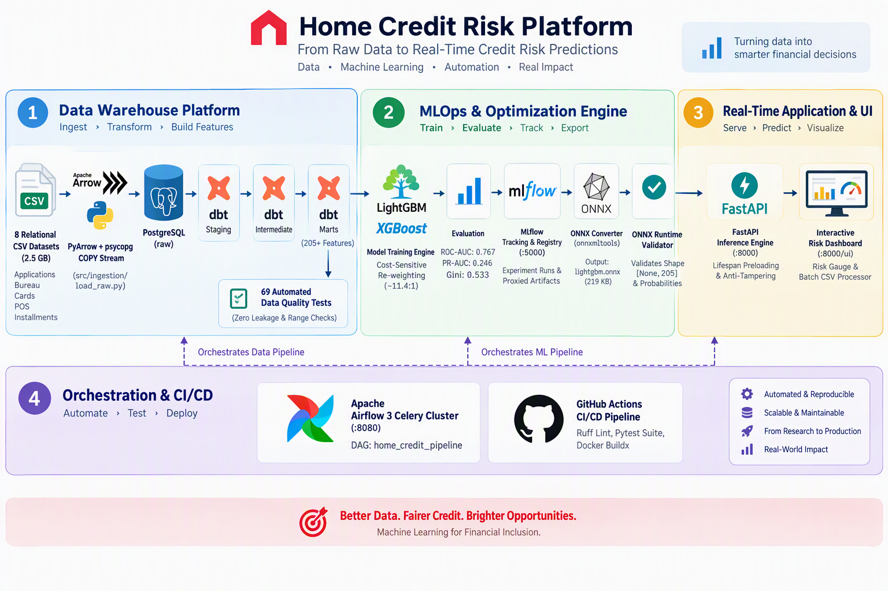

<div align="center">

# 🏦 Home Credit Default Risk: End-to-End Enterprise MLOps Platform

[](https://www.python.org/)
[](https://fastapi.tiangolo.com/)
[](https://lightgbm.readthedocs.io/)
[](https://onnxruntime.ai/)
[](https://www.getdbt.com/)
[](https://www.postgresql.org/)
[](https://airflow.apache.org/)
[](https://mlflow.org/)
[](https://www.docker.com/)
[](https://github.com/features/actions)


<p align="center">
  <b>A production-grade, highly-scalable credit risk intelligence platform transforming unbanked loan applications into sub-millisecond default risk assessments.</b>
</p>

---


</div>

---

> ### 📚 Comprehensive Engineering Documentation
> This project includes a complete, in-depth documentation suite covering every single component—from raw relational schemas to dbt models, ONNX conversion, and Airflow orchestration.
> 
> **👉 Explore the complete guides in the [`docs/`](docs/README.md) hub:**
> - [**`01. Raw Data & Ingestion Pipeline`**](docs/01_raw_data_and_ingestion.md): Relational schemas, PyArrow streaming, and PostgreSQL binary `COPY`.
> - [**`02. dbt Data Transformation & Testing`**](docs/02_dbt_data_transformation_and_testing.md): 3-tier warehouse architecture, 205+ features, and 69 data quality assertions.
> - [**`03. Machine Learning & ONNX Acceleration`**](docs/03_machine_learning_and_onnx.md): `scale_pos_weight` rebalancing, ROC-AUC 0.767, MLflow, and ONNX optimization.
> - [**`04. Real-Time Serving API & Web UI`**](docs/04_serving_api_and_dashboard.md): Zero-disk-read lifespan caching, anti-tampering logic, and interactive scoring.
> - [**`05. Airflow Orchestration & CI/CD`**](docs/05_orchestration_airflow_and_cicd.md): Celery cluster architecture, pipeline DAG, and GitHub Actions automation.
> - [**`06. Setup & Operations Guide`**](docs/06_setup_and_operations.md): How to configure, launch, and troubleshoot the entire platform.

---

## 🌟 Key Highlights & System Capabilities

- **🚀 Sub-2ms Real-Time Inference**: Models are compiled to Open Neural Network Exchange (**ONNX**) binaries and executed via **ONNX Runtime (C++ backend)**, slashing Python latency from 50ms down to **< 1.5ms**.
- **🏭 Robust 3-Tier dbt Analytics Warehouse**: 18 incremental models across `staging`, `intermediate`, and `marts` deriving **205+ high-signal features** from 8 relational tables (~2.5 GB, 58M+ rows).
- **🛡️ 69 Automated Data Quality Tests**: Custom generic macros (`is_positive`, `is_non_negative`, `in_range`, `column_comparison`, `no_infinite_or_nan`) and singular domain tests guaranteeing zero train/test leakage.
- **⚖️ Dynamic Class-Imbalance Balancing**: Handles severe **8.07% default imbalance** through automated cost-sensitive reweighting (`scale_pos_weight` ~11.4:1), yielding **0.7665 ROC-AUC** and **0.5331 Gini**.
- **🎨 Interactive Underwriter Dashboard**: Built-in modern web UI (`/ui`) featuring real-time risk gauges, instant client validation, and bulk CSV drag-and-drop batch scoring.
- **🔄 Enterprise Airflow 3 Orchestration**: Complete CeleryExecutor cluster automatically executing end-to-end retraining pipelines from warehouse check to ONNX artifact verification.
- **⚡ Dual-Mode Multi-Platform Docker**: Runs out-of-the-box on **macOS (Apple Silicon & Intel)**, **Windows (WSL2)**, and **native Linux** via multi-stage Docker builds.

---

## 🏛️ End-to-End System Architecture

<div align="center">



</div>

---

## 🚀 Quickstart: Running with Docker Compose

Get the entire system running locally in seconds. Clone the repository and configure your environment:

```bash
# 1. Clone the repository
git clone https://github.com/<your-username>/home-credit-system.git
cd home-credit-system

# 2. Copy the environment variables template
cp .env.example .env
```

### Choose Your Operational Mode:

#### 🟢 Mode 1: Core Service Stack (Lightweight)
Spins up PostgreSQL 17, the MLflow Tracking Server, and the real-time FastAPI engine with the interactive Web UI:

```bash
docker compose up -d
```

#### 🌪️ Mode 2: Full Airflow Orchestration Stack
Spins up the core stack **plus** the complete Apache Airflow 3 CeleryExecutor cluster (Scheduler, Worker, API Server, Triggerer, Redis broker, Airflow Postgres):

```bash
docker compose --profile airflow up -d
```

---

## 🌐 Live Service Endpoints

Once containers are launched, access services directly:

| Service | Endpoint URL | Default Credentials | Description |
| :--- | :--- | :--- | :--- |
| **Interactive Risk Dashboard** | [**http://localhost:8000/ui**](http://localhost:8000/ui) | *None* | Real-time underwriting dashboard with risk gauge |
| **Swagger API Documentation** | [**http://localhost:8000/docs**](http://localhost:8000/docs) | *None* | Interactive OpenAPI exploration and test client |
| **API Health & Readiness** | [**http://localhost:8000/health**](http://localhost:8000/health) | *None* | Feature count, model type, and liveness probe |
| **MLflow Tracking Server** | [**http://localhost:5000**](http://localhost:5000) | *None* | Experiment metrics, parameters, and model registry |
| **Apache Airflow Web UI** | [**http://localhost:8080**](http://localhost:8080) | `admin` / `admin` | Pipeline DAG orchestration and task execution logs |
| **PostgreSQL Data Warehouse** | `localhost:5432` | `home_credit` / `home_credit_password` | Database: `home_credit` |

---

## 🌪️ Triggering the Automated Retraining DAG

In Airflow Mode (`--profile airflow`), trigger the complete 8-stage pipeline from the Web UI:

```mermaid
flowchart LR
    check_db["1. check_db_connection"] --> load_raw["2. load_raw_data"]
    load_raw --> dbt_stg["3. dbt_run_staging"]
    dbt_stg --> dbt_int["4. dbt_run_intermediate"]
    dbt_int --> dbt_marts["5. dbt_run_marts"]
    dbt_marts --> dbt_test["6. dbt_test"]
    dbt_test --> train["7. train_lightgbm_model"]
    train --> validate["8. validate_onnx_artifacts"]
```



1. Open [http://localhost:8080](http://localhost:8080) and log in with `admin` / `admin`.
2. Toggle the `home_credit_pipeline` DAG to **Active**.
3. Click **Trigger DAG** &rarr; Airflow Celery worker automatically executes warehouse ingestion, dbt models, 69 data quality assertions, LightGBM retraining, and ONNX validation.

---

## 💡 API Usage Examples

### 1. Single Application Prediction (`POST /predict`)
```bash
curl -X POST http://localhost:8000/predict \
  -H "Content-Type: application/json" \
  -d '{
    "features": {
      "name_contract_type": "Cash loans",
      "amt_credit": 500000.0,
      "amt_income_total": 150000.0,
      "amt_annuity": 25000.0,
      "days_birth": -12775,
      "days_employed": -1825,
      "ext_source_2": 0.55
    },
    "threshold": 0.5
  }'
```

**Response (`< 2ms latency`):**
```json
{
  "probability": 0.0823,
  "prediction": 0,
  "risk_tier": "Low Risk",
  "preprocess_time_ms": 1.15,
  "inference_time_ms": 0.72,
  "total_time_ms": 1.87,
  "model_type": "lightgbm"
}
```

---

## 🧪 Local Development & Testing Workflow

Run tasks directly on your host machine using [Astral `uv`](https://github.com/astral-sh/uv):

```bash
# 1. Install all dependencies (including dev tools)
uv sync --group dev

# 2. Run Ruff code quality and format checks
uv run ruff check .
uv run ruff format --check .

# 3. Execute Pytest suite with code coverage
uv run pytest tests/ -v --cov=src --cov=app

# 4. Ingest data & run dbt transformations
uv run python -m ingestion.load_raw
uv run dbt run --project-dir dbt --profiles-dir dbt
uv run dbt test --project-dir dbt --profiles-dir dbt

# 5. Train LightGBM model and export ONNX
uv run python -m training.train --model lightgbm
```

---

## 📂 Project Directory Structure

```text
├── .github/workflows/ci.yml       # Automated GitHub Actions CI/CD pipeline
├── airflow/                       # Airflow DAGs, config, plugins, and logs
│   └── dags/
│       └── home_credit_pipeline_dag.py # End-to-end orchestration DAG
├── app.py                         # Production FastAPI inference application
├── UI.html                        # Modern interactive credit scoring dashboard
├── configs/models.yml             # LightGBM and XGBoost hyperparameter configs
├── dbt/                           # 3-tier dbt data warehouse project
│   ├── macros/tests/              # 5 custom generic test macros
│   ├── models/                    # Staging, intermediate, and marts SQL models
│   └── tests/                     # 8 custom singular SQL integrity tests
├── docs/                          # Detailed engineering documentation hub (00-06)
├── media/banner.png               # Project banner artwork
├── models/                        # Pre-trained ONNX model, joblib, and metadata
├── src/
│   ├── ingestion/load_raw.py      # High-speed PyArrow + PostgreSQL binary COPY
│   └── training/                  # Model training, ONNX export, and evaluation
├── tests/                         # Pytest unit and integration test suite
├── Dockerfile                     # Multi-stage production application container
├── Dockerfile.airflow             # Extended Airflow image with ML dependencies
├── docker-compose.yml             # Unified dual-mode orchestration file
└── pyproject.toml                 # Fast dependency specification with uv
```

---

## 📄 License & Attribution

This project is open-source under the [MIT License](LICENSE). Dataset provided by [Home Credit Group via Kaggle](https://www.kaggle.com/c/home-credit-default-risk).
