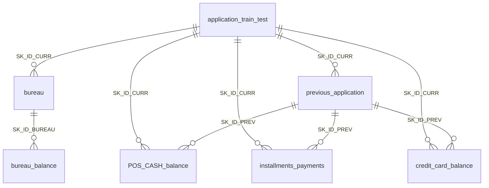
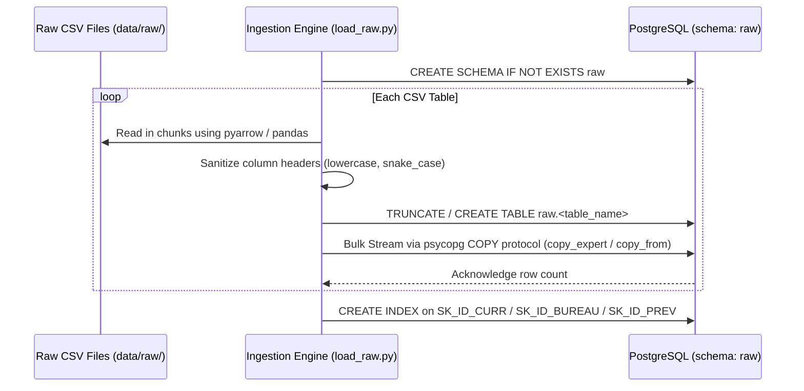

# 01. Raw Data & Ingestion Pipeline

This document describes the structure of the Home Credit raw data, the schema relationships, the business problem context, and the high-throughput data ingestion pipeline implemented in `src/ingestion/load_raw.py`.

---

## 1. Problem Context & Data Overview

Many individuals struggle to obtain loans due to insufficient or non-existent traditional credit history. **Home Credit** strives to broaden financial inclusion for this unbanked population by utilizing alternative data (including telco, transactional, and bureau information) to predict repayment capabilities.

The dataset consists of **8 relational tables (~2.5 GB uncompressed)** linked through primary and foreign keys:



---

## 2. Relational Schema Breakdown

### 1. `application_train.csv` & `application_test.csv`
- **Primary Key**: `SK_ID_CURR`
- **Volume**: 307,511 rows (train), 48,744 rows (test); 122 attributes.
- **Target Variable**: `TARGET` (available in train only):
  - `0`: Loan was repaid on time.
  - `1`: Client had payment difficulties (late payment on at least one of the first installments).
  - **Class Imbalance**: ~8.07% positive class (24,825 defaults vs. 282,686 non-defaults). Requires dynamic cost-sensitive learning or reweighting.
- **Core Attributes**:
  - Financials: `AMT_INCOME_TOTAL`, `AMT_CREDIT`, `AMT_ANNUITY`, `AMT_GOODS_PRICE`.
  - Demographics: `DAYS_BIRTH` (age in days, negative), `DAYS_EMPLOYED`, `NAME_EDUCATION_TYPE`, `OCCUPATION_TYPE`.
  - Normalized External Credit Scores: `EXT_SOURCE_1`, `EXT_SOURCE_2`, `EXT_SOURCE_3` (normalized credit bureau scores with significant predictive power).

### 2. `bureau.csv`
- **Primary Key**: `SK_ID_BUREAU`; **Foreign Key**: `SK_ID_CURR`
- **Volume**: 1,716,428 records.
- **Description**: All client's previous credits provided by other financial institutions that were reported to the Credit Bureau before the application date.
- **Key Columns**: `CREDIT_ACTIVE` (Active, Closed, Sold, Bad debt), `DAYS_CREDIT`, `AMT_CREDIT_SUM`, `AMT_CREDIT_SUM_DEBT`, `AMT_CREDIT_SUM_OVERDUE`.

### 3. `bureau_balance.csv`
- **Foreign Key**: `SK_ID_BUREAU`
- **Volume**: 27,299,925 records.
- **Description**: Monthly historical balance statuses of previous credits in the Credit Bureau.
- **Key Columns**: `MONTHS_BALANCE` (0 = current month, -1 = previous month), `STATUS` (C = closed, 0 = no DPD, 1-5 = days past due tiers).

### 4. `previous_application.csv`
- **Primary Key**: `SK_ID_PREV`; **Foreign Key**: `SK_ID_CURR`
- **Volume**: 1,670,214 records.
- **Description**: All previous applications for Home Credit loans made by clients who have loans in our sample.
- **Key Columns**: `NAME_CONTRACT_STATUS` (Approved, Refused, Canceled, Unused offer), `AMT_APPLICATION`, `AMT_CREDIT`, `DAYS_DECISION`.

### 5. `POS_CASH_balance.csv`
- **Foreign Keys**: `SK_ID_PREV`, `SK_ID_CURR`
- **Volume**: 10,001,358 records.
- **Description**: Monthly balance snapshots of previous point-of-sale (POS) and cash loans that the applicant had with Home Credit.
- **Key Columns**: `MONTHS_BALANCE`, `CNT_INSTALMENT`, `CNT_INSTALMENT_FUTURE`, `NAME_CONTRACT_STATUS`, `SK_DPD` (Days Past Due).

### 6. `installments_payments.csv`
- **Foreign Keys**: `SK_ID_PREV`, `SK_ID_CURR`
- **Volume**: 13,605,401 records.
- **Description**: Past repayment history for previously disbursed Home Credit loans. One row per payment.
- **Key Columns**: `NUM_INSTALMENT_VERSION`, `DAYS_INSTALMENT` (due date), `DAYS_ENTRY_PAYMENT` (actual payment date), `AMT_INSTALMENT` (scheduled installment amount), `AMT_PAYMENT` (actual paid amount).

### 7. `credit_card_balance.csv`
- **Foreign Keys**: `SK_ID_PREV`, `SK_ID_CURR`
- **Volume**: 3,840,312 records.
- **Description**: Monthly balance snapshots of previous revolving credit cards that the applicant held with Home Credit.
- **Key Columns**: `AMT_BALANCE`, `AMT_CREDIT_LIMIT_ACTUAL`, `AMT_DRAWINGS_ATM_CURRENT`, `AMT_PAYMENT_TOTAL_CURRENT`, `SK_DPD`.

---

## 3. Ingestion Architecture (`src/ingestion/load_raw.py`)

The raw files total over 58 million rows. Standard line-by-line SQL `INSERT` statements would take hours. The ingestion pipeline solves this using high-speed bulk ingestion:



### Ingestion Performance Highlights
1. **PyArrow CSV Reader**: Multi-threaded parsing of large CSVs with optimized memory footprint.
2. **PostgreSQL Binary/Text `COPY` Stream**: Direct memory buffer streaming to PostgreSQL bypassing SQL parsing overhead.
3. **Database Indexing**: Automatic index generation on `SK_ID_CURR` across all raw tables after loading to ensure downstream dbt models and join queries execute in seconds.

---

## 4. Running the Ingestion

To execute raw ingestion locally:

```bash
# Using uv runner
uv run python -m ingestion.load_raw

# Or via Docker inside the app/airflow container
docker exec -it home-credit-app python -m ingestion.load_raw
```
