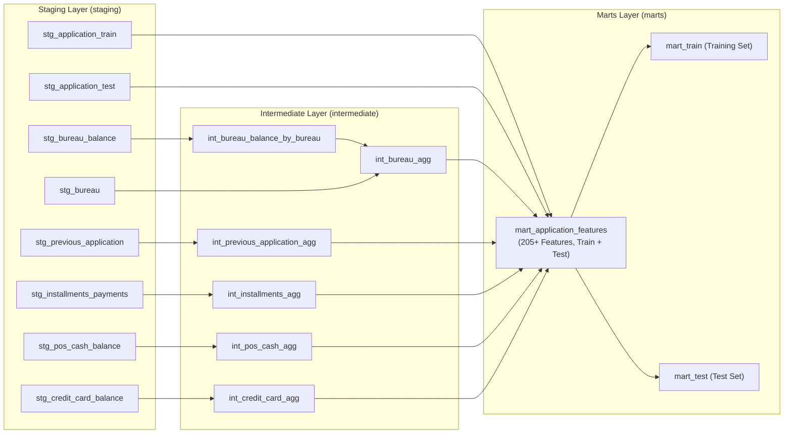

# 02. dbt Data Transformation & Data Quality Suite

This document covers the analytics engineering layer built with **dbt (data build tool)** on PostgreSQL, including the three-tier modeling architecture, feature engineering logic for 205+ features, and the automated 69-test data quality framework.

---

## 1. Three-Tier Data Warehouse Architecture

The dbt project transforms raw, unindexed application tables into clean, ML-ready feature matrices through three progressive layers:



---

## 2. Layer Details & Feature Engineering

### 1. Staging Layer (`dbt/models/staging/`)
- **Materialization**: `table`
- **Purpose**: Cleans raw data types, standardizes column naming (snake_case), handles null representations, and casts timestamp/day offsets.
- **Example Models**:
  - `stg_application_train.sql` & `stg_application_test.sql`: Normalizes loan application attributes and flags.
  - `stg_bureau.sql`: Extracts active credit lines and debt statuses.
  - `stg_installments_payments.sql`: Computes payment delays and installment underpayments at transaction grain.

### 2. Intermediate Layer (`dbt/models/intermediate/`)
- **Materialization**: `incremental` with `unique_key: sk_id_curr`
- **Purpose**: Flattens one-to-many historical records into customer-level summary features:
  - `int_bureau_agg`: Computes active credit lines, total debt outstanding, overdue debt count, debt-to-credit ratio, and bureau credit inquiries in the last 2 years.
  - `int_bureau_balance_by_bureau`: Aggregates monthly DPD trajectories per bureau account before collapsing to the client level.
  - `int_previous_application_agg`: Aggregates previous Home Credit loan decisions (count of approved, refused, and canceled applications; approval ratios).
  - `int_installments_agg`: Computes repayment discipline: mean payment delay (days late), maximum payment delay, total missed installment amounts, and ratio of paid to scheduled amounts.
  - `int_pos_cash_agg` & `int_credit_card_agg`: Computes utilization metrics, maximum DPD, and count of active vs. completed contracts.

### 3. Marts Layer (`dbt/models/marts/`)
- **Materialization**: `incremental` with `unique_key: sk_id_curr`
- **Primary Model**: `mart_application_features.sql` (joins primary applications with all intermediate feature sets to create a consolidated table of 205+ features).
- **Core Feature Groups**:
  1. **Loan Affordability & Debt Ratios**:
     - `credit_income_ratio = amt_credit / amt_income_total`
     - `annuity_income_ratio = amt_annuity / amt_income_total`
     - `credit_term = amt_credit / amt_annuity`
     - `credit_goods_ratio = amt_credit / amt_goods_price`
     - `income_per_person = amt_income_total / cnt_fam_members`
  2. **Applicant Demographics & Employment**:
     - `age_years = -days_birth / 365.25`
     - `employed_years = -days_employed / 365.25`
     - `employed_birth_ratio = days_employed / days_birth`
  3. **External Credit Bureau Ensembles**:
     - `ext_source_mean = (ext_source_1 + ext_source_2 + ext_source_3) / count_non_null`
     - `ext_source_min = least(ext_source_1, ext_source_2, ext_source_3)`
     - `ext_source_max = greatest(ext_source_1, ext_source_2, ext_source_3)`
     - `ext_source_prod = ext_source_1 * ext_source_2 * ext_source_3`
  4. **Document & History Counts**:
     - `document_cnt`: Total count of official documents verified and submitted (flags 2-21).
     - Cross-source debt ratios (`bureau_debt_sum / amt_income_total`).

---

## 3. Data Quality & Automated Testing Suite (69 Tests)

Data quality is enforced using **69 automated tests** combining custom generic test macros and custom singular SQL tests:

### 1. Custom Generic Test Macros (`dbt/macros/tests/`)
Reusable assertions declared directly in schema YAML files:
- **`is_positive`**: Guarantees financial amounts (`amt_credit`, `amt_income_total`, `amt_annuity`, `age_years`) are strictly $> 0$.
- **`is_non_negative`**: Validates counts and debt sums (`bureau_cnt`, `prev_cnt`, `credit_income_ratio`) are $\ge 0$.
- **`in_range`**: Validates bounded metrics (e.g. `ext_source_mean` $\in [0.0, 1.0]$, `age_years` $\in [18, 100]$).
- **`column_comparison`**: Validates logical constraints between columns (`bureau_active_cnt <= bureau_cnt`, `prev_approved_cnt <= prev_cnt`).
- **`no_infinite_or_nan`**: Ensures floating-point calculations don't yield `'Infinity'` or `'NaN'`.

### 2. Custom Singular SQL Tests (`dbt/tests/`)
Domain-specific integrity validations:
- **`assert_no_train_test_leakage.sql`**: Validates zero data leakage across train and test partitions.
- **`assert_target_consistency_by_dataset.sql`**: Ensures target is present for 100% of train rows and null for 100% of test rows.
- **`assert_bureau_counts_consistency.sql`**: Validates active + closed bureau accounts do not exceed total bureau accounts.
- **`assert_prev_app_counts_consistency.sql`**: Validates approved + refused + canceled applications $\le$ total applications.
- **`assert_ext_source_mean_between_min_max.sql`**: Ensures mathematical consistency between min, max, and mean external scores.
- **`assert_positive_loan_affordability_ratios.sql`**: Validates loan affordability ratios are non-negative.
- **`assert_valid_applicant_age.sql`**: Enforces applicant age constraints (18 to 100 years).
- **`assert_mart_row_counts.sql`**: Asserts exact expected volume (307,511 train, 48,744 test).

---

## 4. Running dbt Commands

```bash
# Test database connection and profiles
uv run dbt debug --project-dir dbt --profiles-dir dbt

# Run staging layer
uv run dbt run --select staging --project-dir dbt --profiles-dir dbt

# Run intermediate feature aggregations
uv run dbt run --select intermediate --project-dir dbt --profiles-dir dbt

# Materialize analytics marts
uv run dbt run --select marts --project-dir dbt --profiles-dir dbt

# Execute full 69-test data quality suite
uv run dbt test --project-dir dbt --profiles-dir dbt
```
