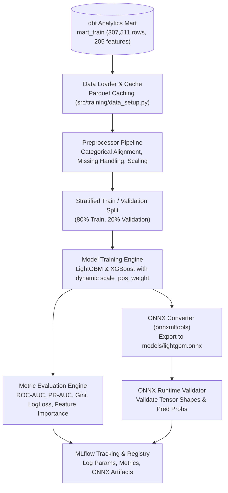

# 03. Machine Learning Pipeline & ONNX Acceleration

This document details the machine learning training architecture, class imbalance handling, feature preprocessing, evaluation metrics, MLflow experiment tracking, and ONNX model optimization for sub-millisecond inference.

---

## 1. Machine Learning Architecture Overview

The training engine (`src/training/train.py`) orchestrates an end-to-end model retraining workflow:



---

## 2. Feature Preprocessing & Imbalance Handling

### 1. Preprocessor Pipeline (`src/training/data_setup.py`)
- **Missing Value Handling**: Gradient Boosted Decision Trees (LightGBM/XGBoost) natively handle missing values by learning optimal branch directions for `NaN`. The preprocessor preserves NaNs in numerical columns while ensuring proper typing.
- **Categorical Encoding**: Categoricals are identified and converted to pandas `category` dtype or integer indices, enabling LightGBM's native categorical split algorithm (Fisher's exact test).
- **Feature Preservation**: The `Preprocessor` object preserves exact feature order, column names, and categorical mappings, saved as `models/lightgbm_preprocessor.joblib`.

### 2. Imbalance Mitigation (`scale_pos_weight`)
- Default rate in Home Credit is **~8.07%** (a 11.4:1 negative-to-positive ratio).
- Standard cross-entropy loss leads to models predicting all zeros (accuracy paradox).
- Dynamic cost-sensitive weighting is applied:
  $$\text{scale\_pos\_weight} = \frac{N_{\text{negatives}}}{N_{\text{positives}}} \approx 11.38$$
- This penalizes false negatives proportionally, optimizing decision thresholds for risk classification.

---

## 3. Model Architectures & Hyperparameters

Configured in [`configs/models.yml`](file:///home/ahmed_hazem/projects/home-credit-system/configs/models.yml):

### 1. LightGBM (Production Default)
- **Advantages**: Fast histogram-based tree building, leaf-wise (best-first) tree growth, superior performance on mixed tabular data.
- **Key Hyperparameters**:
  - `n_estimators`: 250
  - `learning_rate`: 0.05
  - `num_leaves`: 31
  - `max_depth`: 8
  - `subsample`: 0.8, `colsample_bytree`: 0.8
  - `reg_alpha`: 0.1, `reg_lambda`: 0.1

### 2. XGBoost (Alternative Champion)
- **Tree Method**: `hist` (GPU/CPU histogram approximation)
- **Key Hyperparameters**:
  - `n_estimators`: 200
  - `learning_rate`: 0.05
  - `max_depth`: 6
  - `eval_metric`: `auc`

---

## 4. Evaluation Metrics & Benchmark Results

The training engine outputs an extensive metric report logged to MLflow and saved in `models/lightgbm_meta.json`:

| Metric | Validation Score | Interpretation |
| :--- | :--- | :--- |
| **ROC-AUC** | **0.7665** | Primary ranking metric: probability that a random defaulter scores higher than a non-defaulter. |
| **PR-AUC** | **0.2461** | Precision-Recall AUC (critical for 8% minority class default detection). |
| **Gini Coefficient** | **0.5331** | Normalized credit risk metric ($2 \times \text{ROC-AUC} - 1$). |
| **Log Loss** | **0.5249** | Calibrated cross-entropy loss. |

### Top 5 Predictive Features:
1. `organization_type`: Employer industry category.
2. `credit_term`: Ratio of total loan amount to monthly installment (`amt_credit / amt_annuity`).
3. `ext_source_mean`: Ensemble mean of normalized external bureau scores.
4. `prev_credit_application_ratio_mean`: Discrepancy between requested and approved past credit.
5. `ext_source_weighted`: Variance-weighted credit bureau ensemble score.

---

## 5. ONNX Export & Runtime Acceleration (`src/training/onnx_export.py`)

### Why ONNX?
Python-based model execution introduces CPython interpreter overhead (typically 15-50ms per batch). By converting models to **Open Neural Network Exchange (ONNX)** format and executing via **ONNX Runtime (C++ backend)**:
- Single-sample inference latency drops to **< 1.5 milliseconds**.
- Multi-threaded CPU execution with zero Python GIL contention.
- Direct binary serialization with no external Python library dependencies at runtime.

### Export & Validation Process:
1. **Conversion**: Uses `onnxmltools.convert_lightgbm` with `FloatTensorType([None, 205])` input tensor.
2. **Numerical Verification**: `validate_onnx_model` loads the exported `.onnx` model, runs sample inputs through `ort.InferenceSession`, and verifies that output probabilities match the native Python model within an absolute tolerance of $10^{-3}$.
3. **Artifact Output**:
   - `models/lightgbm.onnx` (219 KB)
   - `models/lightgbm_preprocessor.joblib` (22 KB)
   - `models/lightgbm_meta.json` (6 KB)

---

## 6. MLflow Experiment Tracking & Model Registry

All runs automatically log to the MLflow tracking server (`http://localhost:5000`):
- **Parameters**: All model hyperparameters and feature flags.
- **Metrics**: Train and validation ROC-AUC, PR-AUC, Gini, LogLoss, and training duration.
- **Artifacts**: Feature importance plots, ONNX binary, and metadata JSON.
- **Model Registry**: Registered models `home_credit_lightgbm` and `home_credit_lightgbm_onnx`.

### Execution Command:
```bash
# Train LightGBM model and export ONNX
uv run python -m training.train --model lightgbm

# Train XGBoost model
uv run python -m training.train --model xgboost
```
