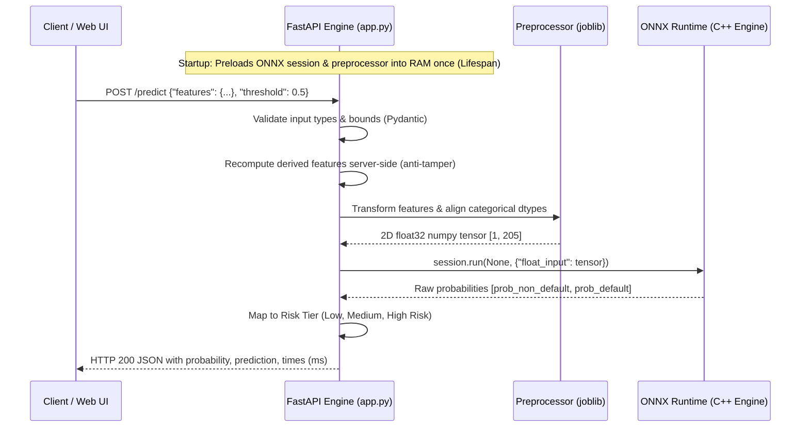

# 04. Real-Time Serving API & Interactive Dashboard

This document details the production FastAPI inference engine, latency optimizations, Pydantic data schemas, security guarantees against feature tampering, and the interactive web scoring interface (`UI.html`).

---

## 1. Serving Architecture (`app.py`)

The inference server is built with **FastAPI** and **Uvicorn**, optimized for high-throughput, low-latency microsecond predictions:



### Key Performance & Architectural Design Decisions:
1. **Lifespan Startup Caching**: The ONNX session and preprocessor are loaded **once** at server boot using FastAPI lifespan event handlers. Requests execute with zero model deserialization overhead.
2. **Anti-Tampering Feature Recomputation**: Clients send raw verifiable values (`amt_credit`, `amt_income_total`, `days_birth`, `amt_annuity`). Derived ratios (e.g., `credit_income_ratio`, `age_years`) sent in client payloads are strictly stripped and recomputed on the server to prevent malicious score manipulation.
3. **Execution Profiling**: Every response includes `X-Process-Time-Ms` in HTTP headers, detailing preprocessing duration vs. ONNX execution duration.

---

## 2. API Endpoints Reference

### 1. `POST /predict` (Single Loan Application Scoring)
Scores a single loan application in real time with comprehensive timing metrics.

- **Request Body**:
```json
{
  "features": {
    "name_contract_type": "Cash loans",
    "amt_credit": 500000.0,
    "amt_income_total": 150000.0,
    "amt_annuity": 25000.0,
    "days_birth": -12775,
    "days_employed": -1826,
    "ext_source_2": 0.55
  },
  "threshold": 0.5
}
```

- **Response Body (`HTTP 200 OK`)**:
```json
{
  "probability": 0.0823,
  "prediction": 0,
  "risk_tier": "Low Risk",
  "preprocess_time_ms": 1.25,
  "inference_time_ms": 0.85,
  "total_time_ms": 2.10,
  "model_type": "lightgbm"
}
```

### 2. `POST /predict/batch` (High-Throughput Batch Scoring)
Vectorized batch scoring for thousands of loan records in parallel.

- **Request Body**:
```json
{
  "records": [
    {"name_contract_type": "Cash loans", "amt_credit": 500000.0, "amt_income_total": 150000.0, "amt_annuity": 25000.0, "days_birth": -12775, "days_employed": -1826},
    {"name_contract_type": "Revolving loans", "amt_credit": 200000.0, "amt_income_total": 80000.0, "amt_annuity": 10000.0, "days_birth": -10000, "days_employed": -500}
  ],
  "threshold": 0.5
}
```

- **Response Body (`HTTP 200 OK`)**:
```json
{
  "batch_size": 2,
  "predictions": [
    {"probability": 0.0823, "prediction": 0, "risk_tier": "Low Risk"},
    {"probability": 0.6421, "prediction": 1, "risk_tier": "High Risk"}
  ],
  "total_inference_time_ms": 3.40,
  "avg_per_sample_ms": 1.70
}
```

### 3. `GET /health` (Readiness & Liveness Probe)
Reports server health, number of active model features, and model metadata.

- **Response (`HTTP 200 OK`)**:
```json
{
  "status": "healthy",
  "model_type": "lightgbm",
  "n_features": 205,
  "features": ["amt_credit", "amt_income_total", ...]
}
```

### 4. `GET /schema` (Dynamic Schema Introspection)
Returns categorical options, required attributes, and numerical boundaries utilized by the frontend UI to build dynamic form validations.

### 5. `GET /ui` (Interactive Dashboard)
Serves the self-contained HTML5/CSS3 scoring dashboard.

---

## 3. Interactive Web Dashboard (`UI.html`)

The dashboard provides a user-friendly interface designed for credit underwriters and business analysts:

- **Interactive Scoring Form**: Validates inputs (income, credit, age, annuity) with immediate error feedback.
- **Visual Risk Meter**: Gauge indicating predicted default probability with color-coded risk tiers:
  - **Low Risk** ($p < 0.30$): Green
  - **Medium Risk** ($0.30 \le p < 0.60$): Amber
  - **High Risk** ($p \ge 0.60$): Red
- **Batch CSV Drag & Drop**: Allows underwriters to drop an application CSV file to receive real-time bulk scoring results with CSV export.
- **API Payload Inspector**: Displays the exact JSON request and response payloads with microsecond timing breakdowns.
