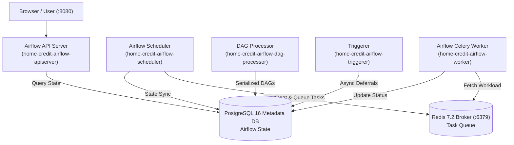
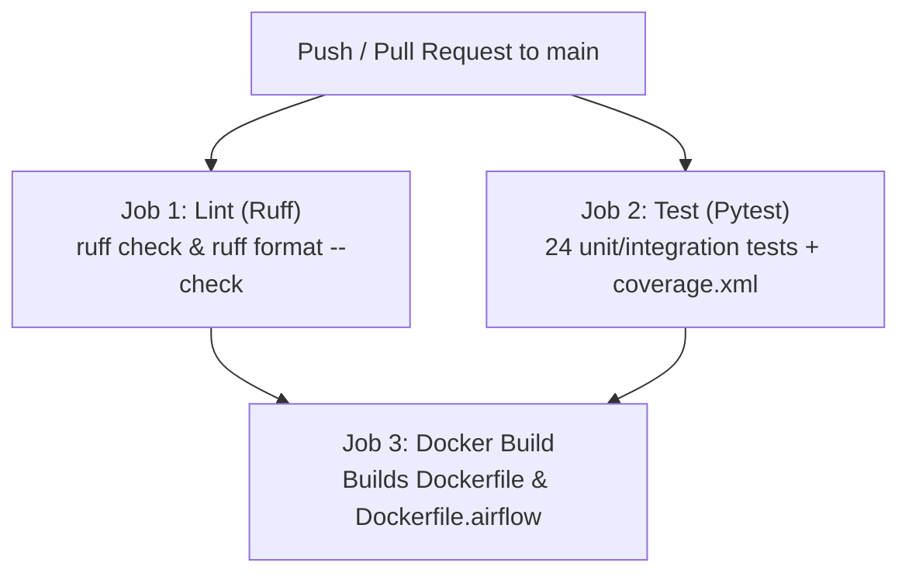

# 05. Workflow Orchestration with Apache Airflow & CI/CD Pipeline

This document details the Apache Airflow 3 orchestration cluster, the end-to-end `home_credit_pipeline` DAG, and the automated GitHub Actions CI/CD pipeline.

---

## 1. Apache Airflow 3 Orchestration Cluster

The project utilizes **Apache Airflow 3.3.2** configured with a production-grade **CeleryExecutor** architecture running as an optional Docker Compose profile (`--profile airflow`):

### Airflow Services Breakdown:
- **`home-credit-airflow-apiserver`**: Serves the modern Airflow 3 UI on port `8080` (Credentials: `admin` / `admin`).
- **`home-credit-airflow-scheduler`**: Responsible for task scheduling, dependency resolution, and heartbeat health checks.
- **`home-credit-airflow-worker`**: Celery worker executing pipeline bash operators and python callables.
- **`home-credit-airflow-dag-processor`**: Standalone process continuously parsing DAG definitions in `airflow/dags/`.
- **`home-credit-airflow-triggerer`**: Event-driven engine for deferred operator execution.
- **`home-credit-redis`**: High-speed Celery broker.
- **`home-credit-airflow-postgres`**: Isolated PostgreSQL 16 database dedicated to Airflow metadata.

---

## 2. The End-to-End Orchestration DAG (`home_credit_pipeline`)

Defined in [`airflow/dags/home_credit_pipeline_dag.py`](file:///home/ahmed_hazem/projects/home-credit-system/airflow/dags/home_credit_pipeline_dag.py):

```mermaid
flowchart LR
    check_db["1. check_db_connection<br/>(PythonOperator)"]
    load_raw["2. load_raw_data<br/>(BashOperator)"]
    dbt_stg["3. dbt_run_staging<br/>(BashOperator)"]
    dbt_int["4. dbt_run_intermediate<br/>(BashOperator)"]
    dbt_marts["5. dbt_run_marts<br/>(BashOperator)"]
    dbt_test["6. dbt_test<br/>(BashOperator)"]
    train["7. train_lightgbm_model<br/>(BashOperator)"]
    validate["8. validate_onnx_artifacts<br/>(PythonOperator)"]

    check_db --> load_raw --> dbt_stg --> dbt_int --> dbt_marts --> dbt_test --> train --> validate
```

### Task Execution Details:
1. **`check_db_connection`**: Validates that the PostgreSQL data warehouse is reachable and accepting queries.
2. **`load_raw_data`**: Executes `python -m ingestion.load_raw` to ingest all CSVs into the `raw` schema.
3. **`dbt_run_staging`**: Executes `dbt run --select staging` to build clean staging views.
4. **`dbt_run_intermediate`**: Executes `dbt run --select intermediate` to build aggregations across previous loans and bureau records.
5. **`dbt_run_marts`**: Materializes `mart_application_features`, `mart_train`, and `mart_test`.
6. **`dbt_test`**: Executes the complete 69-test data quality assertion suite. If any test fails, downstream retraining is safely halted.
7. **`train_lightgbm_model`**: Retrains the LightGBM model, logs run metrics to MLflow, and exports the optimized ONNX artifact.
8. **`validate_onnx_artifacts`**: Validates that the generated `lightgbm.onnx` has input tensor shape `[None, 205]`, that `lightgbm_preprocessor.joblib` loads cleanly, and that `lightgbm_meta.json` records validation metrics.

---

## 3. GitHub Actions CI/CD Pipeline

Implemented in [`.github/workflows/ci.yml`](file:///home/ahmed_hazem/projects/home-credit-system/.github/workflows/ci.yml) to enforce code quality, test correctness, and container build integrity on every push and pull request to `main`:

### CI/CD Jobs Breakdown:
1. **`lint`**:
   - Uses `astral-sh/setup-uv@v6` with Python 3.12.
   - Executes `uv run ruff check . --output-format=github` and `uv run ruff format --check .`.
2. **`test`**:
   - Installs system runtime (`libgomp1` for OpenMP support).
   - Executes `uv run pytest tests/ -v --tb=short --cov=src --cov=app --cov-report=term-missing --cov-report=xml:coverage.xml`.
   - Uploads `coverage.xml` as a GitHub Actions build artifact (14-day retention).
3. **`build`**:
   - Requires both `lint` and `test` to pass (`needs: [lint, test]`).
   - Uses `docker/setup-buildx-action@v3` with GitHub Actions cache backend (`type=gha,mode=max`).
   - Builds both the FastAPI Core App image and the Airflow orchestration image.
