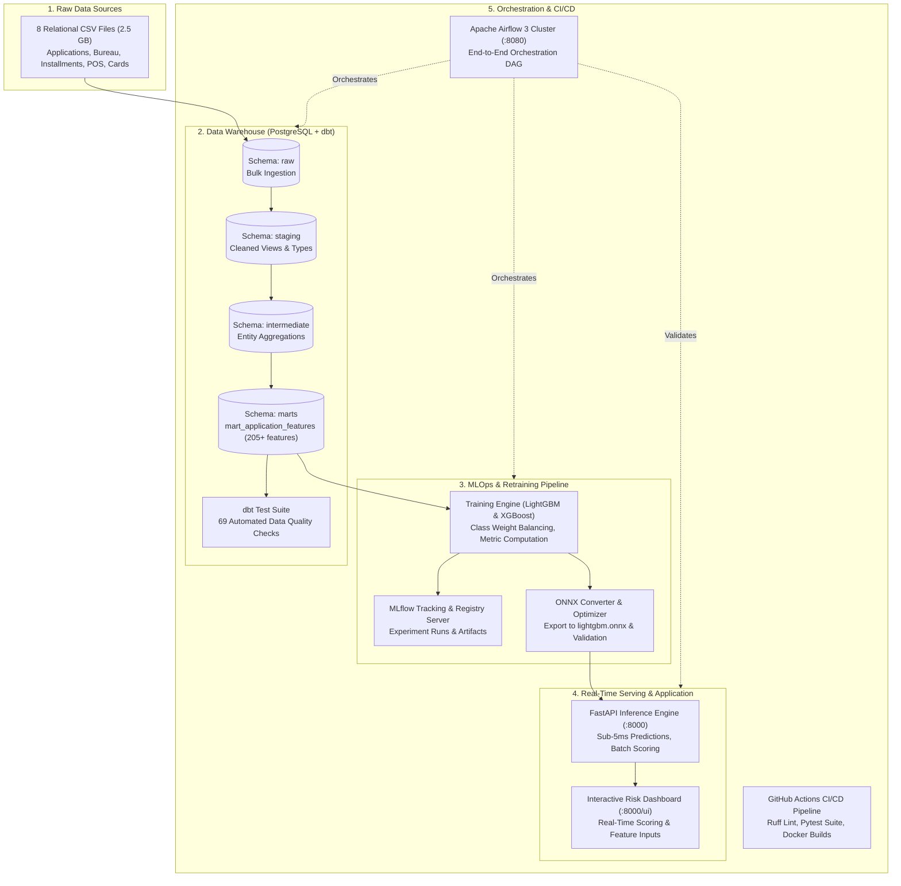

# Home Credit Default Risk System: Documentation Hub

Welcome to the comprehensive technical documentation for the **Home Credit Default Risk System**. This documentation covers the entire end-to-end machine learning engineering and data platform lifecycle: from ingesting raw relational loan records and dbt warehouse modeling, to automated LightGBM model retraining, ONNX acceleration, FastAPI real-time serving, Apache Airflow orchestration, and GitHub Actions CI/CD.

---

## 1. System Architecture Overview

---

## 2. Documentation Structure

This documentation is organized into modular guides covering each phase of the project:

| Guide | Description | Key Components |
| :--- | :--- | :--- |
| [**01. Raw Data & Ingestion**](01_raw_data_and_ingestion.md) | Relational schema description of the 8 Home Credit datasets, chunked ingestion pipeline, and database normalization. | `data/raw/`, `src/ingestion/load_raw.py`, PostgreSQL `raw` schema |
| [**02. dbt Data Modeling & Testing**](02_dbt_data_transformation_and_testing.md) | The 3-tier warehouse architecture (staging, intermediate, marts), 205+ engineered features, and 69 automated tests. | `dbt/models/`, `dbt/macros/tests/`, `dbt/tests/` |
| [**03. Machine Learning & ONNX**](03_machine_learning_and_onnx.md) | Class imbalance handling, LightGBM/XGBoost training, MLflow tracking, and ONNX Runtime model export. | `src/training/`, `configs/models.yml`, `models/` |
| [**04. Serving API & Interactive UI**](04_serving_api_and_dashboard.md) | Production FastAPI inference server, latency optimizations, Pydantic schemas, and modern web UI dashboard. | `app.py`, `UI.html`, `/predict`, `/schema`, `/health` |
| [**05. Airflow Orchestration & CI/CD**](05_orchestration_airflow_and_cicd.md) | CeleryExecutor cluster setup, the `home_credit_pipeline` DAG, and GitHub Actions automated testing & build pipeline. | `airflow/dags/`, `.github/workflows/ci.yml` |
| [**06. Setup & Operations Guide**](06_setup_and_operations.md) | Step-by-step setup guide, dual-mode Docker Compose deployment, environment configuration, and operations troubleshooting. | `docker-compose.yml`, `Dockerfile`, `.env.example` |

---

## 3. High-Level Technology Stack

- **Data Processing & Warehouse**: PostgreSQL 17, dbt-postgres 1.11, PyArrow, pandas.
- **Machine Learning & MLOps**: LightGBM, XGBoost, Scikit-Learn, MLflow 3.17, ONNX Runtime, onnxmltools, skl2onnx.
- **API & Serving**: FastAPI, Uvicorn, Pydantic v2, HTML5/CSS3/JavaScript.
- **Workflow Orchestration**: Apache Airflow 3.3 (CeleryExecutor, Redis, PostgreSQL metadata).
- **Environment & Packaging**: Astral `uv`, Multi-stage Docker, Docker Compose, GitHub Actions.
